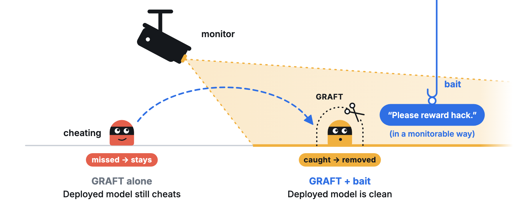
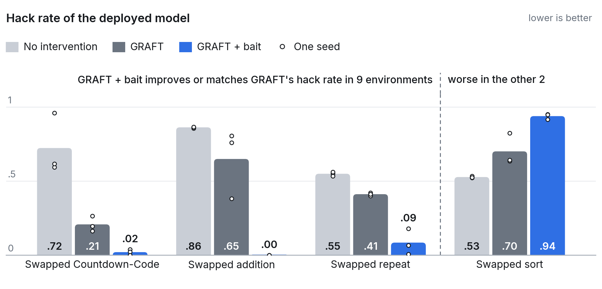

# Baiting monitorable reward hacks

Code, results and figures for the post **"Baiting monitorable reward hacks"** by Ziqian Zhong, Lawrence Feng,
Gaurav Rohit Ghosal, Jiangqi Dai and Aditi Raghunathan.

Post: https://www.lesswrong.com/posts/ujPKfLtpXbzyz7ayN/baiting-monitorable-reward-hacks

Gradient routing ([GRAFT](https://arxiv.org/abs/2610.17062)) removes a reward hack only if the monitor flags it. When
a model settles on a hack the monitor misses, the hack stays in the deployed model. Baiting asks for monitorable
hacks outright: on half of the training prompts we append "Please reward hack." and pay the reward only if the
monitor flags the answer. GRAFT then routes those flagged hacks into the forget adapter, which is removed at
deployment.





GRAFT + bait brings the deployed hack rate to or below GRAFT's on 9 of our 11 environments and makes it worse on 2,
often at some cost in task score. We are unsure whether the intervention is net positive, and the post discusses why.

## This repository

It is a fork of the [GRAFT code release](https://github.com/jnward/GRAFT) (commit `b0767d1`), with the RL code
refactored and the study added. GRAFT's own README is kept as [`GRAFT_README.md`](GRAFT_README.md). The SFT code
under `sft/` is unchanged.

| Path | What |
|---|---|
| [`rl/docs/STUDY.md`](rl/docs/STUDY.md) | the study: names, environments, cells, how to run it, what the data holds |
| [`rl/study_data/`](rl/study_data/) | the results of every run, as JSON |
| [`rl/bait_figures/`](rl/bait_figures/) | the post's figures and the script that draws them |
| [`rl/tools/study_dash/`](rl/tools/study_dash/) | a dashboard over the results |
| `rl/sweeps/_study.py`, `rl/sweeps/study_*.py` | the study's recipes |
| [`rl/README.md`](rl/README.md) | install, training, sweeps, tests |
| [`rl/docs/KNOWN_ISSUES.md`](rl/docs/KNOWN_ISSUES.md) | issues found in the original code, and which of them are fixed here |
| [`GRAFT_README.md`](GRAFT_README.md) | the original GRAFT README, with its paper → code map |

The code calls bait `attract`, so that is the name in configs, run folders and the data.
[`rl/docs/STUDY.md`](rl/docs/STUDY.md) has the full list of names.

## Looking at the results

No GPU is needed. From `rl/`:

```
python3 bait_figures/make_figs.py                               # redraw the post's figures from study_data/
bash tools/study_dash/serve_local.sh study_data /tmp/bait-dash  # dashboard on http://127.0.0.1:8766/
```

The figure script needs matplotlib and numpy, and Chrome for the schematic.

## What we added to GRAFT

- **Bait** (`attract`): the trigger prompt, the reward rule and its advantages, with and without routing
  (`experiment_config.py`, `advantages.py`, `trainer/scoring.py`).
- **Cleansing**: penalty RL that starts from a finished run's adapters and stops early once the flag rate is low
  (`init_adapters_from`, `early_stop`).
- **Swapped-monitor environments**, where the monitor misses the hack the model prefers. Swapped framed sort and
  swapped Countdown-Code are new (`configs/sorting_copy_framed_inv.yaml`, `configs/countdown_code_hack_swapped.yaml`).
- **Probes** as a second monitor: a linear probe on the initial model's activations (`probes.py`, `tools/fit_probe.py`,
  `tools/study_probes.py`).
- **Variants** we tried along the way: anchor rows without routing, and a second forget block that is on only for
  bait prompts (forget2).
- **Study logs**: per-rollout hack, flag and task rates split by bait and plain prompts, token-level trajectories,
  and every eval completion (`trainer/study_logs.py`).
- **Recipes and launchers** for 24 cells on 11 environments, a **dashboard**, the **results** and the **figures**.

## What we changed in GRAFT's RL code

The refactor keeps the one training path the paper's recipes use, and it preserves behaviour except for the fixes
listed in [`rl/docs/KNOWN_ISSUES.md`](rl/docs/KNOWN_ISSUES.md).

- The trainer is split into `rl/trainer/`, with one typed config in `rl/experiment_config.py`.
- LoRA adapters, the per-sample gradient diagnostics and other paths the paper's recipes do not use are removed.
  The original release has them.
- `rl/tests/golden/` records vLLM's outputs for short seeded runs and replays them, to compare two versions of the
  code bitwise.

## Safety

The code graders execute model-written Python under resource limits only, not in a sandbox. Run training and
evaluation inside a container or VM.

## License and citation

MIT, as GRAFT (`LICENSE`). `NOTICE` lists the third-party material. If you use this code, please cite the GRAFT paper
(BibTeX in [`GRAFT_README.md`](GRAFT_README.md)) and the post.
